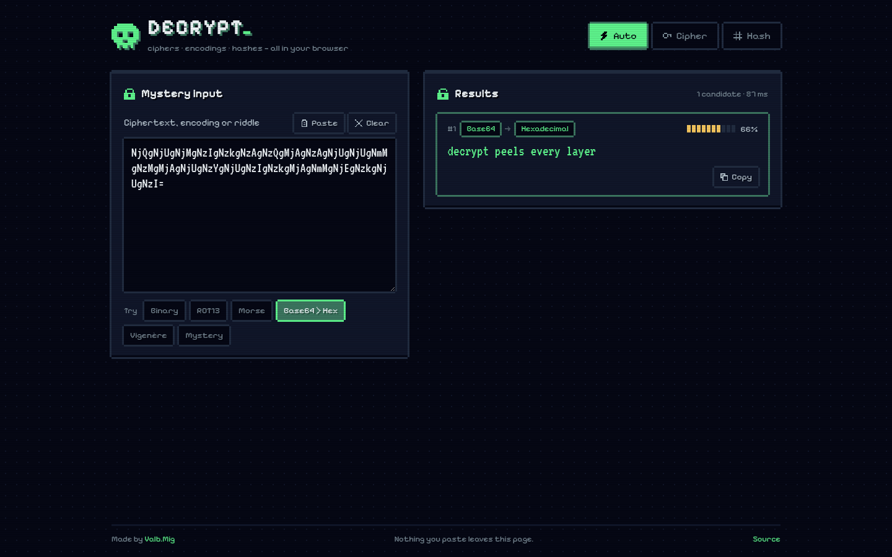

# 🧟 Decrypt

Paste a mystery string and Decrypt peels it layer by layer until something readable comes out. Ciphers, encodings and hashes, all decoded in the browser — nothing you paste leaves the page.



### 🔗 [decrypt-kappa.vercel.app](https://decrypt-kappa.vercel.app/)

## What it does

- **Auto** — tries every decoder and chains of them (up to three layers, e.g. Base64 → hex → Caesar), then ranks the candidates by how much they read like English or Portuguese.
- **Cipher** — pick one of 19 ciphers, decode or encode with your own key, or brute force the key when you don't have it (Caesar, Affine, Rail fence and Vigenère).
- **Hash** — identify 20+ hash formats, crack MD5, MD4, NTLM and SHA-1/256/384/512 against a built-in or uploaded wordlist (with mutations like `Password1`, `p4ssw0rd`), or generate digests.

| Group | Ciphers |
| --- | --- |
| Encodings | Binary, Octal, Decimal, Hexadecimal, Base32, Base58, Base64, URL |
| Codes | Morse, A1Z26, Baconian, Polybius square |
| Ciphers | Caesar / ROT13, ROT47, Atbash, Affine, Vigenère |
| Transposition | Rail fence, Reverse |

## How the ranking works

Every candidate gets a readability score from a character trigram model trained on public-domain books (Project Gutenberg) and Portuguese Wikipedia, plus a small common-word list. The solver runs breadth-first in a Web Worker, prunes keyed ciphers that don't clearly improve the text, and favors structural decodes (Base64, hex…) over guesses.

## Structure

```
src/
  core/            framework-free domain, plain TypeScript
    cipher/        Cipher contract, factories (radix, table, rank) and the 19 strategies
    score/         readability score and the generated trigram model
    solve/         auto solver (chain search)
    hash/          identification, MD4/MD5, Web Crypto SHA, wordlist cracker
    text/          bytes and alphabet helpers
  ui/
    kit/           pixel design system (Box, Button, Field, Tabs, Meter, Tag, Icon…)
    views/         Auto, Cipher, Hash and the page shell
    hooks/         debounce, clipboard, routing, worker-backed solver
    work/          Web Worker entry
  app/             Next.js routing, fonts and global tokens
scripts/model.ts   rebuilds src/core/score/model.ts from text corpora
tests/             Vitest suites for core
```

## Scripts

```bash
pnpm dev      # local server
pnpm build    # production build
pnpm test     # core test suite
pnpm check    # type check
node scripts/model.ts src/core/score/model.ts --en books/*.txt --pt livros/*.txt
```

## Stack

TypeScript · Next.js 16 · React 19 · Vitest · Vercel
